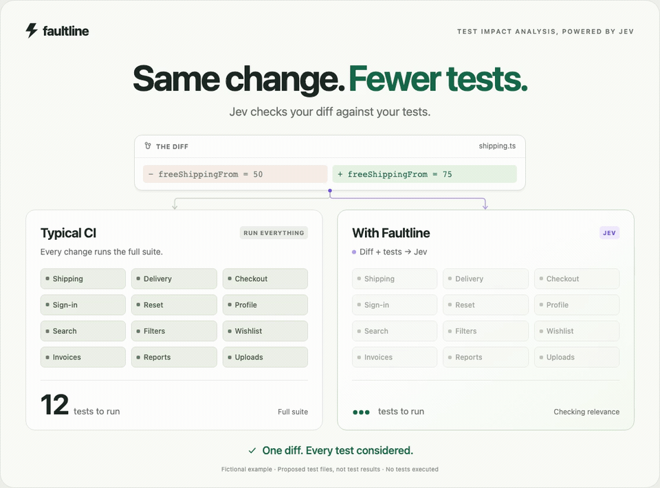
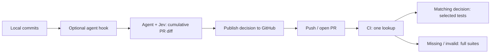

# Faultline

Faultline fingerprints declared CI task inputs and dependencies so unchanged
checks can reuse successful results. It also records source relationships and
explains which tests a file change can reach. Jev remains optional and off.

The goal is to reduce CI work while retaining useful regression detection.
Task caching defaults to **full execution for validation**; explicit `--reuse`
enables successful-result reuse. Source impact assessment remains report-only
by default. Both paths keep uncertainty visible while you validate the contract.

[](docs/demo/faultline-jev-tia.mp4)

[Watch the 8-second video](docs/demo/faultline-jev-tia.mp4) · [Try the interactive demo](docs/demo/README.md). The demo uses invented data.

## Inspect dependencies without Jev

For reusable CI check results, use the new [task input graph](docs/tasks.md) and
[configuration skill](skills/faultline-tasks/SKILL.md). It fingerprints declared
inputs and transitive dependencies across products. `tasks run` keeps full checks
running for validation; `tasks run --reuse` explicitly reuses matching successes.
This is separate from the source graph and parser baseline described below.

Install the [packaged CLI and agent skill](docs/install.md), configure
`faultline.json`, then run:

```sh
faultline assess --base <cumulative-merge-base> --head HEAD
faultline graph build --output .faultline/graph.json
faultline graph affected --file src/price.ts --output .faultline/impact.json
faultline graph compare --base <base-commit> --head HEAD
```

These commands read committed source and return human/agent-readable JSON with
dependency paths, revisions and unresolved targets. They execute no tests and
need no Jev key. The [GitHub source-baseline template](skills/faultline/assets/faultline-graph.yml)
shares parser facts between runs while existing tests keep running. Consumers
install one pinned package; they do not commit a copy of the engine.

The new workflow is a [commit-pinned preview](docs/install.md#with-a-coding-agent)
on `codex/graph-default`, pending adoption on the default branch.

## Optional Jev assessment

1. Configure where your tests live in `faultline.json`. Faultline reads their source at the exact Git revision, without starting the application.
2. Start with the cumulative diff. If the diff leaves behavior implicit, such as inherited behavior, an external patch, or a dependency update, your agent gathers focused source evidence. Faultline verifies and freezes it.
3. Explicit `assess --jev` retains graph-positive tests and scores the unresolved test source. Faultline batches the work, keeps valid answers, and reports incomplete assessments explicitly.
4. Compare RUN/OMIT proposals at different relevance thresholds, then check them against existing CI outcomes. For an explicit CI pilot, export a compact file selection; CI needs no Jev call.

The default graph workflow reuses source relationships and validated Behat/Playwright runtime observations. Reports distinguish positive paths, mandatory rules and unresolved tests; no missing path authorizes an omission. Explicit `assess --jev` adds Noul scoring for unresolved tests. The agent skill and Python CLI use the same engine; CI consumes published file selections without an agent session.

Required tests and uncertain assessments stay RUN. Relevance is not a failure probability or a guarantee of preserved coverage. A smaller selection only becomes useful evidence once you check what it detects and misses.

## Get started

Install the self-contained skill (Git, Python 3.10+, and npm for the installer):

```bash
npx skills add https://github.com/ronaldtebrake/faultline --skill faultline --global
```

Follow [installation and configuration](docs/install.md), then ask your agent:

> Use Faultline to assess this PR with the dependency graph. Show affected paths, mandatory rules, unresolved tests and cache reuse. Keep full CI running and save an offline HTML report.

`assess` and `select` need no API key. Graph facts reuse unchanged Git objects automatically. Optional Jev research requires `--jev`, including when resuming a paid run; [commands](docs/commands.md) explains the separate contracts and budgets.

- [Architecture](docs/architecture.md): what runs where and what gets stored.
- [Commands](docs/commands.md): setup, assess, resume, and report.
- [CI setup](docs/ci.md): automatic PR selections, optional hooks, and the comparison pilot.
- [Validation plan](PLAN.md): what remains before selective CI execution.
- [Anonymized comparison](docs/evaluation/selector-comparison.md): the earlier evidence behind the Jev-only direction.
- [Performance milestone](docs/evaluation/jev-performance.md): fresh-call experiments, measured costs, and what is still experimental.

## Optional selective GitHub CI experiment

The default [source-baseline workflow](skills/faultline/assets/faultline-graph.yml) reports graph impact alongside full CI. Graph reports cannot be exported as selections. The separate workflow below requires explicit adoption; it is not the graph-validation default.



A small synthetic `faultline.json` uses your existing full runner commands:

```json
{
  "schema_version": 2,
  "scope": ["src/**", "tests/**", "features/**", "composer.*"],
  "suites": [
    {
      "id": "unit", "runner": "phpunit", "sources": ["tests/**/*Test.php"],
      "command": ["vendor/bin/phpunit", "--configuration", "phpunit.xml"]
    },
    {
      "id": "acceptance", "runner": "behat", "sources": ["features/**/*.feature"],
      "command": ["vendor/bin/behat", "--config", "behat.yml"]
    }
  ]
}
```

Connect your existing runtime setup, then CI runs:

```bash
faultline ci-fetch --repository owner/project --target-branch main \
  --base-ref <exact-target-tip> --output .faultline/selection.json
faultline ci-run --selection .faultline/selection.json --runners phpunit behat playwright \
  --execute --output .faultline/pr-execution.json
```

Use the complete [publisher workflow](skills/faultline/assets/faultline-publish.yml) and [automatic PR workflow](skills/faultline/assets/faultline-pr.yml), with [setup instructions](docs/ci.md). Optional [Cursor, Claude Code and Codex hooks](skills/faultline/references/hooks.md) block an agent push until a selection or explicit full fallback is published. The [manual pilot](skills/faultline/assets/faultline-pilot.yml) remains available to compare selected and full execution at the same revision.

| Situation | CI behavior |
| --- | --- |
| Matching decision | Run selected files and required prerequisites, preserving variants. |
| Complete assessment selects nothing | Honor explicit `none` after setup and native validation. |
| No assessment, expired artifact or retrieval failure | Run fully, without waiting for scoring. |
| Wrong revision, diff base, configuration, publisher or invalid data | Ignore the selection and run fully. |
| Incomplete scoring or exhausted budget | Widen affected suites; the agent can publish a full fallback without more inference. |
| Unverifiable inventory or filtering | Run the affected full suite. |
| Broken setup, missing/unreviewed execution configuration or runner failure | Fail visibly; never report successful empty execution. |

A mismatched **selection** falls back; missing or unreviewed **runner configuration** stops the pilot. The automatic job tests the exact PR head, while existing required merge checks remain in place. Hooks cannot intercept every push, and `none` does not skip application setup or validation. The 50% cutoff is experimental, not a guarantee of regression detection.
