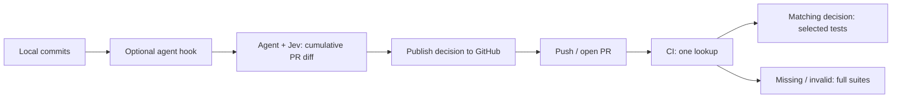

# Faultline

Faultline uses Jev to propose which tests to run for a PR or MR. It compares the cumulative diff with actual test source, then reports the selection, its reasons, and inference costs.

The goal is to reduce CI work while retaining useful regression detection. Today, Faultline is **report-only by default**: your CI keeps running its tests while you evaluate what Faultline would have selected. An opt-in PHPUnit, Behat or Playwright CI pilot can execute exported selections alongside full-run comparisons.

[](docs/demo/faultline-jev-tia.mp4)

[Watch the 8-second video](docs/demo/faultline-jev-tia.mp4) · [Try the interactive demo](docs/demo/README.md). The demo uses invented data.

## How it works

1. Configure where your tests live in `faultline.json`. Faultline reads their source at the exact Git revision, without starting the application.
2. Start with the cumulative diff. If the diff leaves behavior implicit, such as inherited behavior, an external patch, or a dependency update, your agent gathers focused source evidence. Faultline verifies and freezes it.
3. Jev scores every readable configured test file. Faultline batches the work, keeps valid answers, and reports incomplete assessments explicitly.
4. Compare RUN/OMIT proposals at different relevance thresholds, then check them against existing CI outcomes. For an explicit CI pilot, export a compact file selection; CI needs no Jev call.

The source interface works across languages and text-based test frameworks. The default workflow needs no generated description catalog or separate graph. An opt-in [dependency baseline](docs/dependencies.md) reuses source relationships and Behat/Playwright runtime observations to retain known affected tests without Jev scoring. The agent skill and Python CLI use the same engine; CI consumes published file selections without an agent session.

Required tests and uncertain assessments stay RUN. Relevance is not a failure probability or a guarantee of preserved coverage. A smaller selection only becomes useful evidence once you check what it detects and misses.

## Get started

Install the self-contained skill (Git, Python 3.10+, and npm for the installer):

```bash
npx skills add https://github.com/ronaldtebrake/faultline --skill faultline --global
```

Follow [setup and API-key steps](docs/install.md), then ask your agent:

> Use Faultline to assess this PR. Start with the diff and collect only missing implementation evidence. Show the expected Jev work and keep total Jev usage below $0.90, including retries. Save a shareable HTML report with 10%, 25%, and 50% relevance comparisons. Do not run tests or change CI.

Each new assessment is fresh by default. Paid progress stays in one journal per run; cross-run answer reuse is optional. The HTML report works offline, without JavaScript. [See a synthetic sample](docs/demo/report.html).

- [Architecture](docs/architecture.md): what runs where and what gets stored.
- [Commands](docs/commands.md): setup, assess, resume, and report.
- [CI setup](docs/ci.md): automatic PR selections, optional hooks, and the comparison pilot.
- [Validation plan](PLAN.md): what remains before selective CI execution.
- [Anonymized comparison](docs/evaluation/selector-comparison.md): the earlier evidence behind the Jev-only direction.
- [Performance milestone](docs/evaluation/jev-performance.md): fresh-call experiments, measured costs, and what is still experimental.

## Optional GitHub CI

Prepare once before pushing; CI consumes the decision immediately or runs fully. Keep existing required checks during this experimental pilot.



A small synthetic `faultline.json` uses your existing full runner commands:

```json
{
  "schema_version": 2,
  "scope": ["src/**", "tests/**", "features/**", "composer.*"],
  "suites": [
    {
      "id": "unit", "runner": "phpunit", "sources": ["tests/**/*Test.php"],
      "command": ["vendor/bin/phpunit", "--configuration", "phpunit.xml"]
    },
    {
      "id": "acceptance", "runner": "behat", "sources": ["features/**/*.feature"],
      "command": ["vendor/bin/behat", "--config", "behat.yml"]
    }
  ]
}
```

Connect your existing runtime setup, then CI runs:

```bash
faultline ci-fetch --repository owner/project --target-branch main \
  --base-ref <exact-target-tip> --output .faultline/selection.json
faultline ci-run --selection .faultline/selection.json --runners phpunit behat playwright \
  --execute --output .faultline/pr-execution.json
```

Use the complete [publisher workflow](skills/faultline/assets/faultline-publish.yml) and [automatic PR workflow](skills/faultline/assets/faultline-pr.yml), with [setup instructions](docs/ci.md). Optional [Cursor, Claude Code and Codex hooks](skills/faultline/references/hooks.md) block an agent push until a selection or explicit full fallback is published. The [manual pilot](skills/faultline/assets/faultline-pilot.yml) remains available to compare selected and full execution at the same revision.

| Situation | CI behavior |
| --- | --- |
| Matching decision | Run selected files and required prerequisites, preserving variants. |
| Complete assessment selects nothing | Honor explicit `none` after setup and native validation. |
| No assessment, expired artifact or retrieval failure | Run fully, without waiting for scoring. |
| Wrong revision, diff base, configuration, publisher or invalid data | Ignore the selection and run fully. |
| Incomplete scoring or exhausted budget | Widen affected suites; the agent can publish a full fallback without more inference. |
| Unverifiable inventory or filtering | Run the affected full suite. |
| Broken setup, missing/unreviewed execution configuration or runner failure | Fail visibly; never report successful empty execution. |

A mismatched **selection** falls back; missing or unreviewed **runner configuration** stops the pilot. The automatic job tests the exact PR head, while existing required merge checks remain in place. Hooks cannot intercept every push, and `none` does not skip application setup or validation. The 50% cutoff is experimental, not a guarantee of regression detection.
