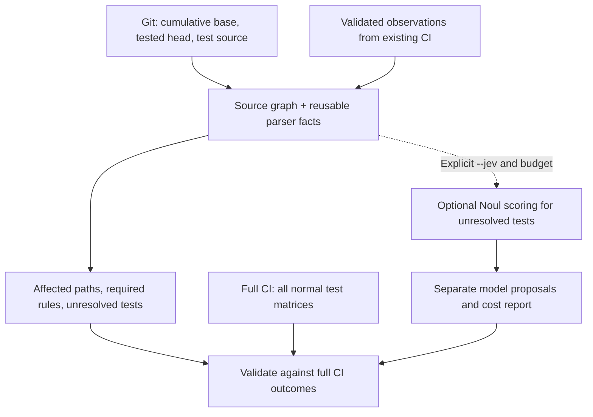

# Architecture

Faultline has one Python engine, distributed as a CLI and inside an agent skill. It uses Git for source snapshots and dependency graphs by default. Jev relevance scoring is optional and off. Source analysis needs neither a running application nor a test runner.

## Responsibilities

| Component | Job |
| --- | --- |
| Coding agent | Configure test paths, resolve PR revisions, collect focused evidence when implementation is missing, explain results. |
| Git | Supply exact source at base/head without switching branches. |
| Faultline engine | Verify inputs, resolve dependency paths, reuse source facts, preserve mandatory rules and unknowns, and save offline reports. |
| Jev | Return a five-level relevance distribution for each supplied change–test relationship. |
| Existing CI | Run tests and supply outcomes. Faultline does not schedule containers, services, or jobs. |

`assess` and `select` default to `graph-v1`. They compare old and new source paths and accept validated runtime observations without collecting new ones. Unresolved targets are not proven independent. Graph reports require `full_suite` CI and cannot become executable selection manifests. Source facts reuse unchanged blobs automatically; new definitions can still change resolution between unchanged files.

Optional `assess --jev` retains graph-positive targets before scoring unresolved ones. An agent can supply verified context when changed behavior is otherwise absent. A key, configuration or saved run never substitutes for explicit paid opt-in.

## Optional Jev evidence and proposals

Each target is a complete test file in a suite and variant. Faultline prefers whole inputs; oversized pairs are split into explicit source/change windows. Every part needs a valid answer. Windowed scores use the strongest part relevance, so interactions across windows remain unassessed.

The saved omission rule requires `P(irrelevant) ≥ 95%`. Offline 10%, 25%, and 50% comparisons instead use `P(plausible + strong + direct)`, excluding weak relevance. These are different rules. Mandatory tests, shared-input changes, and incomplete evidence can override either rule.

Jev receives the selected change context and test source. It receives no later CI outcomes. Source verification checks authenticity, not whether the agent found every relevant connection. Reports keep relevance, observed regression recall, measured coverage, and savings separate.

## Shared and local data

Commit `faultline.json` with your project. Test source is already shared through Git; local configuration is recorded with each analysis, including historical ones.

Ignored `.faultline/` holds the API key and private evidence. Each paid `assess --jev` run has a small directory under `runs/`: immutable input identity, one append-only progress journal, frozen results and generated reports. Before each request, Faultline persists the attempt; validated answers and returned usage follow. Resuming keeps the same inputs and request ceiling. Interrupted requests with no returned usage remain potentially billed and unknown.

Graph runs freeze their report and reuse parser facts, with zero inference cost. New paid assessments bypass cross-run answers by default. `--reuse-cache` opts into a disposable, exact-input SQLite cache capped at 64 MiB. SQLite is supplied by most Python builds; fresh assessments, progress and reports work without it. There is no database service or graph index. Cache failure is a visible miss; failure to save run evidence stops spending. Advanced `benchmark` commands retain their older cache behavior.

Git source blobs are read in bounded batches, preserving exact bytes while avoiding a separate Git process per test. The five-level evaluator, thresholds and serial transport are unchanged by this packaging work. The pooled/Noul performance experiments remain separate.

Paid reports include 10/25/50% comparisons, newly accepted/recovered/reused answer counts and dated Jev input estimates. Engine-to-report time includes source preparation and initial rendering; agent investigation, installation and final metadata export are outside that clock. Missing token usage or agent costs remain unknown.

Shadow commands never run tests. Optional native discovery can load application code. Explicit `run --execute` currently validates and runs a full suite; selective execution remains future work. See the skill’s [execution reference](../skills/faultline/references/execution.md) for that separate workflow.
